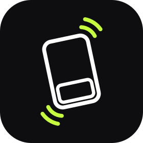
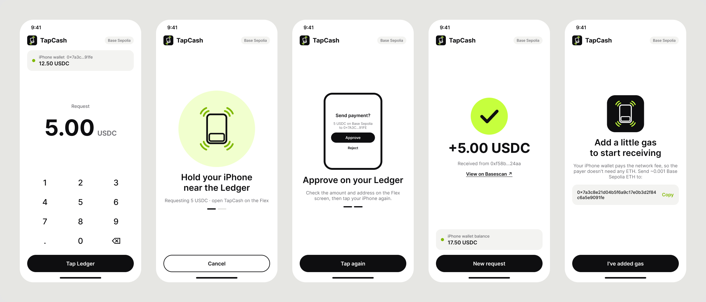

<p align="center"></p>

<h1 align="center">TapCash</h1>

<p align="center">Tap your Ledger Flex on an iPhone to pay in USDC on Base.</p>

- **No app for the receiver.** The iPhone side runs in Safari.
- **No ETH for the payer.** The receiver's phone pays the gas working like a paymaster. 
- **Nothing signed blind.** The Flex shows the amount, chain and receiver before it signs.
- **Mainnet/testnet.** Real USDC transactions on mainnet and simulated virtual cards on testnet. 

Live at https://tapcash-ruby.vercel.app/site, and tested with real USDC on Base mainnet.

## Why

Today a hardware wallet is a signer. A wallet app builds the payment, and the Ledger only approves it.

TapCash turns the Ledger into the thing you pay with. You tap it like a card: the Flex gets the request, shows it, signs it and hands over the payment. The payer needs no phone or computer, only their Ledger.

## How a payment works

1. **Request.** The receiver enters an amount on the iPhone and holds it to the Flex.
2. **Approve.** The Flex shows "Send payment? 5 USDC on Base to 0x…". The payer approves.
3. **Tap again.** The Flex hands over the signed transfer. The phone checks it and sends it.
4. **Done.** The phone shows the payment and a Basescan link, usually within seconds.



*The iPhone screens, from the [Figma file](https://www.figma.com/design/LoU2gSRJTr4rTEfDQxxVbk/TapCash-Logo): request, hold near the Ledger, approve on the Flex, received, and the first-time gas setup.*

Afterwards, the receiver can move the USDC to their own Ledger, or on testnet, cash it out to a sandbox Visa card.

## How the tap works

iPhone apps need a paid Apple developer account to use NFC this way, but Safari can already use NFC security keys for logins (WebAuthn). So the Flex app poses as a security key. The payment request goes where a login sends a key ID, and the signature comes back where a key returns its login signature.

The Flex builds the transfer from the request and signs that, never a hash from the page. What it signs is exactly what it shows.

## Ways to pay

Chosen on the Flex:

| Mode | How it works | Good for |
| --- | --- | --- |
| **Manual** (default) | Review every payment: tap, approve, tap. | Any amount |
| **Budget** | One tap, no review, within limits you set (per payment, total, count). | Lots of small payments |
| **Card** | The next payment goes through on one tap, any amount. Turns off after that, or after a minute. | Paying at a counter |

## Mainnet and testnet

Tap the network label at the top of the page to switch between **Base Sepolia** (test money, the default) and **Base** (real USDC).

- The Flex names the chain, and a signature only works on that chain.
- New phones get gas automatically: test ETH on Sepolia, about $0.10 of ETH on mainnet.
- Card cash-out is a sandbox demo, so it's testnet only.

## Safety

- **Keys** never leave the Flex's secure chip.
- **Each signature** covers one amount, one receiver, one chain and a random nonce, and expires in an hour.
- **Budget and card mode** trade review for speed. Like a contactless card, someone who taps your unlocked Flex can spend what's left of the budget, or any amount in card mode. Both reset when the app closes.
- **The iPhone wallet** is a key stored in Safari. Keep small amounts there and move the rest to a Ledger.

## Try it

**With a Flex and an iPhone:**
1. Install the TapCash app on the Flex ([`SETUP.md`](SETUP.md), section 5).
2. Send USDC to the Flex: free test USDC from https://faucet.circle.com, or real USDC on Base.
3. Open https://tapcash-ruby.vercel.app in Safari, enter an amount and tap.

**Without hardware:** the tests run the full flow on the Ledger emulator ([`SETUP.md`](SETUP.md), section 4).

## Architecture

```
  Payer                               Receiver
┌──────────────┐   NFC tap 1: request   ┌──────────────────┐
│ Ledger Flex  │ ◀───────────────────── │ iPhone, Safari   │
│ TapCash app  │                        │ tapcash page     │
│              │   NFC tap 2: signature │ (burner wallet)  │
│ secure chip  │ ─────────────────────▶ │                  │
└──────────────┘                        └────────┬─────────┘
                                                 │ transferWithAuthorization
                                                 │ (phone pays gas)
                        ┌──────────────┐         ▼
                        │ Vercel APIs  │   ┌───────────┐
                        │ gas top-up   │──▶│ Base USDC │
                        │ card cashout │   └───────────┘
                        └──────────────┘
```

- **The Flex** takes a request and returns a signature. It never goes online.
- **The phone** checks the signature, sends the transaction and shows the result.
- **The APIs** are optional. Without them you add gas by hand and cash-out is hidden.

## Two-minute demo

1. Open TapCash on the Flex.
2. On the iPhone, type `1` and press **Tap Ledger**.
3. Hold the phone to the Flex. Check "1 USDC on Base Sepolia" and touch **Approve**.
4. Tap again. The phone shows "+1 USDC".
5. Turn on **card mode** on the Flex, request `2` and tap once. It pays immediately.
6. Switch the page to **Base** and repeat with real USDC.

## FAQ

**What does the payer need?**
Just their Ledger Flex. The receiver needs an iPhone with Safari.

**Why two taps?**
iOS closes the NFC connection while the Flex waits for approval, so a second tap picks up the signature. Budget and card mode need only one.

**Who pays the gas?**
The receiver's phone. A payment on Base costs well under a cent, and new phones get gas automatically.

**Can the page trick the Flex into signing something else?**
No. The Flex only signs USDC transfers on Base or Base Sepolia, built from fields it shows on screen.

**What if Safari's data is cleared?**
The phone's wallet is lost, along with anything in it. That's why the page offers "Move to my Ledger" after each payment.

**Android?**
Untested. We've only tried iPhone Safari.

## What's next

In progress:
- **Private receiving** (PR #10): a new receiving address for every payment.
- **Ledger Wallet CLI** (PR #8): check, top up and empty the TapCash address from a terminal.
- **DMK setup page** (PR #7): confirm the Flex address over USB.

Later:
- A real card off-ramp in place of the sandbox.
- Gas paid in USDC, so the receiver needs no ETH.
- More tokens and chains.

## Built with

- **Flex app:** C on the Ledger secure SDK, with a minimal U2F responder and EIP-712 signing.
- **iPhone page:** one static HTML file with viem, hosted on Vercel.
- **APIs:** two Vercel functions, for gas top-ups and the Increase sandbox cash-out.
- **Payments:** USDC `transferWithAuthorization` (EIP-3009) on Base.

## Repo

| Path | What |
| --- | --- |
| `mvp/tapcash/flex-app/` | Ledger Flex app |
| `mvp/tapcash/web/` | iPhone page and APIs |
| `mvp/tapcash/web/site/` | Product website |
| `mvp/tapcash/test*.mjs` | Emulator tests |

Internals and request format: [`mvp/tapcash/README.md`](mvp/tapcash/README.md). Build and run: [`SETUP.md`](SETUP.md).

## Limits

- **Two taps** in manual mode, because of how iOS handles NFC.
- **Not private yet.** All payments come from the Flex's one address.
- **A signed cheque, not cash.** If the payer spends the balance before the phone sends the transfer, it fails.
- **iPhone and Safari only** so far, with the TapCash app open on the Flex.
